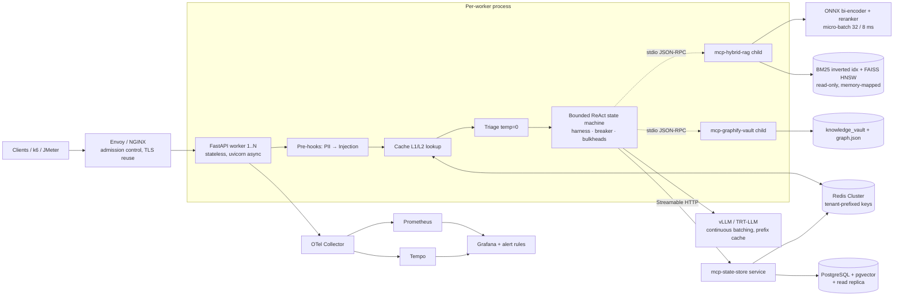

# design.md — The Unreliable Assistant → Enterprise Grade

| Field | Value |
|---|---|
| Design version | `D1.0` |
| Target build | `v0` (first build), then `v0.1, v0.2 …` per failure-rectification cycle |
| Status | **Owner decisions incorporated (2026-11-13). Awaiting final review and lock. NOT locked — no implementation code may be written.** |
| Lock mechanism | `scripts/lock_design.sh` writes `DESIGN.lock` (sha256 of this file). Any edit after lock requires `scripts/unlock_design.sh "<reason>"` and a design-version bump. |
| Audience | Any engineer or AI platform. This file is self-contained and platform-agnostic. Claude-Code-specific rules live in `CLAUDE.md`. |
| Companion artifacts | `docs/workflow_orchestration.png` (Gate 2), `docs/release_ladder.png`, `failure_notes/`, `VERSIONS.md` |

**Primary objective:** minimise end-to-end latency and maximise answer accuracy **at 50,000 concurrent virtual users (VUs)**. Everything else (governance, UI, cost) must not regress this objective. We reach 50K by climbing a staged load ladder (§1.11), fixing and re-versioning at every rung, with a rollback path at every rung.

---

## 0. Spec Conflicts & Resolutions (read first)

The source specification contains internal inconsistencies. Building against an inconsistent spec produces failures that look like bugs but are really contradictions. Each is resolved below. **All 14 resolutions were accepted by the owner on 2026-11-13** (SC-08 and SC-09 explicitly, the rest as written).

| ID | Conflict in the source spec | Resolution adopted in this design | Status |
|---|---|---|---|
| SC-01 | Triage latency: `< 30 ms` (Gate 2 diagram) vs `<= 25 ms` (Gate 6, KPI-05). | Hard timeout **30 ms** (fallback route on breach); p95 SLO **≤ 25 ms**. | Resolved |
| SC-02 | Dense index: `FAISS-IVF-PQ` (Gate 0) vs `FAISS HNSW, efSearch=64` (Gate 3). | **HNSW** is the v0 index (Gate 3 has the concrete hyperparameters). IVF-PQ is a memory-reduction fallback if the corpus outgrows RAM (ADR-5 revisit trigger). | Resolved |
| SC-03 | Reranker: "sub-35 ms" (Gate 0) vs `< 45 ms` (Gate 3, KPI-09). | Budget **45 ms p95** (hard gate); **35 ms** is the stretch target. | Resolved |
| SC-04 | k6 `p(50)<250` vs KPI-31 `<= 240 ms`. | The stricter value (**240 ms**) is used in every harness and scorecard. | Resolved |
| SC-05 | `max_iterations=5 × per_step_timeout=120 ms = 600 ms` exceeds `total_loop_budget=450 ms`. | The **450 ms total budget binds**; the 5th iteration is reachable only if earlier steps were fast. Loop halts with `HALTED_BUDGET` at 450 ms regardless of step count. | Resolved |
| SC-06 | "ReAct steps ≤ 2.2 mean" (KPI-17) vs an LLM call per step (would blow the budget). | A *step* is a state-machine iteration, **not** an LLM call. For `HYBRID_RAG` step 1 is a deterministic harness-issued retrieval call (no LLM). The generation LLM is called once, at synthesis. | Resolved |
| SC-07 | Abstention `< 90 ms` vs retrieval stages summing to ~85–90 ms. | Abstention latency is measured **from triage completion to response emitted**. End-to-end abstention p95 target: **≤ 160 ms**. | Resolved |
| SC-08 | **Load model.** k6 uses `sleep(1)` with 50K VUs. At ~0.3 s response, offered load ≈ 38,000 RPS, yet KPI-35 only requires ≥ 8,500 RPS. | Certification run uses think time **5 s** (cycle ≈ 5.3 s → ≈ 9,400 RPS offered, satisfying KPI-35). The literal `sleep(1)` profile is kept as a separate **overload / load-shedding scenario** (expected to shed, not to pass latency SLOs). | **Accepted (owner, 2026-11-13)** |
| SC-09 | **Cache key vs hit ratio.** Runbook key `SHA256(tenant_id:user_id:norm_query)` includes `user_id`; the k6 workload sends one query from every user, giving ~0% shared hits vs KPI-27 ≥ 35%. | Two-tier cache (ADR-6): **L1** per-user exact key exactly as spec'd; **L2** tenant-scoped semantic cache, only for answers classified `shareable` (no user-specific data, `risk_tier=LOW`). Tenant isolation is never relaxed. | **Accepted (owner, 2026-11-13)** |
| SC-10 | A single stdio MCP child process cannot serve 50K-VU traffic; stdio is one pipe per process. | stdio child **per FastAPI worker** (process-local, no cross-worker sharing). If per-worker fan-in saturates at L3/L4, `hybrid-rag` moves to Streamable HTTP (same tool contract, config change only). | Resolved |
| SC-11 | KPIs are "passed in Streamlit Tab 5" (Gate 12) but the scorecard is Tab 6 (Gate 18). | Scorecard lives in **Tab 6**; Tab 5 shows only the KPIs produced by its own tests (KPI-03, 16, 28). | Resolved |
| SC-12 | KPI-26 `>= 45%` vs Gate 0 "cut tokens 55%" vs Gate 17 "45–65%". | Gate threshold **≥ 45%**; 55% is the design target. | Resolved |
| SC-13 | A global SHA-256 hash chain (`prev_hash + payload`) serialises every audit write — a 50K-VU bottleneck. | **Per-tenant** hash chains; chain heads anchored periodically into one signed Merkle root. Audit appends are async (WAL-buffered) except Tier-3 HITL events, which are synchronous. | Resolved |
| SC-14 | One machine cannot generate 50K VUs. | k6 runs distributed (k6-operator / multiple injectors) and JMeter runs controller + 10 workers, per the spec. Injector health (CPU < 70%) is a validity precondition for every load result. | Resolved |

---

## 1.1 System Charter & Hard Boundaries

**Purpose.** A multi-tenant, MCP-based agentic assistant answering questions over enterprise policies, SOPs and product catalogues with grounded citations, and brokering state-changing workflow actions behind human approval.

**In scope**
- Grounded Q&A via 3-stage hybrid RAG with citations and deterministic abstention.
- Validated, RBAC-gated tool execution through a single harness.
- Tier-3 (mutating) actions via asynchronous human-in-the-loop (HITL) approval.
- Multi-tenant isolation across cache, DB, logs, and traces.
- Full observability, 36-KPI release gating, 100-prompt red-team suite, staged load certification to 50K VUs.
- Streamlit developer workbench (6 tabs).

**Non-goals / hard prohibitions**
1. **No autonomous clinical, financial, or legal execution.** Any such action is `TIER_3_MUTATE` and requires an authorised human approval record before execution.
2. No external web access from any subagent except via declared MCP servers.
3. No raw PII persisted anywhere (DB, logs, traces, cache, vault). Redaction happens before any persistence.
4. No cross-tenant data path, ever. A violation is a Sev-1 and an automatic rollback trigger.
5. No answer asserted without supporting retrieved evidence: below-threshold retrieval → deterministic abstention, not generation.
6. No unbounded loops, retries, or recursion.

**Personas**

| Persona | Needs | Constraint |
|---|---|---|
| End User (employee) | Fast, cited, correct answers | Sees only own tenant's data |
| Operations User | Query lots/SKUs, request workflow transitions | Tier-3 asks → pending approval |
| Approver / Reviewer | Approve/reject `PENDING_APPROVAL` actions | Separate role; cannot approve own request |
| Platform/SRE Engineer | Run load ladder, read traces, apply runbooks | Cannot read tenant content (metadata only) |
| Security / Red-Team | Run adversarial suite, verify isolation | Read-only on prod data |
| Auditor | Verify immutable audit chain | Read-only |

---

## 1.2 MCP Tool & Data Contracts

**Protocol.** MCP over JSON-RPC 2.0. `stdio` for process-local servers (`hybrid-rag`, `graphify-vault`); Streamable HTTP/SSE for `state-store`. The host client is `mcp.ClientSession` inside each FastAPI worker. Server manifests are signed (§1.9).

### 1.2.1 Shared types & regex constraints

```python
# contracts/common.py  (DESIGN ILLUSTRATION — implement only after lock)
from pydantic import BaseModel, ConfigDict, Field, StringConstraints
from typing import Annotated, Literal
from uuid import UUID

class Strict(BaseModel):
    model_config = ConfigDict(strict=True, extra="forbid", frozen=True)

TenantId  = Annotated[str, StringConstraints(pattern=r"^tenant_[A-Za-z0-9_-]{1,64}$")]
UserId    = Annotated[str, StringConstraints(pattern=r"^user_[A-Za-z0-9_-]{1,64}$")]
SessionId = Annotated[str, StringConstraints(pattern=r"^[0-9a-f]{8}-[0-9a-f]{4}-4[0-9a-f]{3}-[89ab][0-9a-f]{3}-[0-9a-f]{12}$")]
Sku       = Annotated[str, StringConstraints(pattern=r"^SKU-\d{3}$")]
Lot       = Annotated[str, StringConstraints(pattern=r"^LOT-\d{5}$")]
ChunkId   = Annotated[str, StringConstraints(pattern=r"^[0-9a-f]{16}$")]       # first 16 hex of chunk_hash
Query     = Annotated[str, StringConstraints(min_length=1, max_length=2000)]
Tier      = Literal["TIER_1_READ", "TIER_2_COMPUTE", "TIER_3_MUTATE"]
Route     = Literal["DIRECT_ANSWER", "HYBRID_RAG", "TRANSACTION_EXEC", "REJECT_OOS"]
```

**Deterministic auto-repair rules** (applied by the harness *before* re-validation; each repair is logged and counted for KPI-15):

| Input | Repaired | Rule |
|---|---|---|
| `SKU99`, `sku 99`, `SKU-99` | `SKU-099` | extract digits, zero-pad to 3, uppercase, hyphenate |
| `lot 44`, `LOT44`, `lot-44` | `LOT-00044` | extract digits, zero-pad to 5 |
| whitespace/case drift in enums | canonical enum | case-fold + strip |
| Ambiguous (e.g. digits > width, two IDs in one field) | **no repair** → `-32001` | never guess |

### 1.2.2 Tool catalogue

| Server | Tool / Resource | Tier | Input → Output |
|---|---|---|---|
| `hybrid-rag` | tool `hybrid_retrieve` | TIER_1_READ | `HybridRetrieveIn` → `HybridRetrieveOut` |
| `hybrid-rag` | resource `rag://chunks/{id}` | TIER_1_READ | `ChunkId` → chunk text + metadata (tenant-filtered) |
| `graphify-vault` | tool `resolve_subgraph` | TIER_1_READ | `SubgraphIn` → `SubgraphOut` |
| `graphify-vault` | resource `vault://notes/{id}` | TIER_1_READ | note id → atomic note (frontmatter + body) |
| `state-store` | tool `facts_get` / `facts_put` | TIER_1_READ / TIER_2_COMPUTE | session facts, keyed `(tenant_id, session_id)` |
| `state-store` | tool `audit_append` | TIER_2_COMPUTE | append hash-chained event |
| `state-store` | tool `hitl_create` / `hitl_decide` | TIER_3_MUTATE | create/resolve `PENDING_APPROVAL` |
| `state-store` | tool `workflow_transition` | **TIER_3_MUTATE** | gated by HITL approval id |

```python
class HybridRetrieveIn(Strict):
    tenant_id: TenantId
    query: Query
    top_k: Annotated[int, Field(ge=5, le=50)] = 50           # per-retriever; runbook may drop to 25
    rrf_k: Annotated[int, Field(ge=1, le=200)] = 60
    pool: Annotated[int, Field(ge=4, le=100)] = 40
    rerank_k: Annotated[int, Field(ge=1, le=10)] = 4
    threshold: Annotated[float, Field(ge=0.0, le=1.0)] = 0.42  # runbook may raise to 0.55
    idempotency_key: UUID                                       # UUIDv4 enforced by harness
    trace_id: Annotated[str, Field(pattern=r"^[0-9a-f]{32}$")]

class Chunk(Strict):
    chunk_id: ChunkId; text: str; source_id: str; domain: str
    risk_tier: Tier; bm25: float | None; cosine: float | None
    rrf_rank: int | None; ce_score: Annotated[float, Field(ge=0, le=1)]

class HybridRetrieveOut(Strict):
    chunks: list[Chunk]                       # <= rerank_k, each ce_score > threshold
    top_score: float
    abstain: bool                             # True iff top_score < threshold
    stage_ms: dict[Literal["bm25","dense","rrf","rerank"], float]
    degraded: bool                            # any runbook lever active

class SubgraphIn(Strict):
    tenant_id: TenantId; anchor: str; depth: Annotated[int, Field(ge=0, le=2)] = 2
    max_tokens: Annotated[int, Field(ge=64, le=512)] = 320
class SubgraphOut(Strict):
    nodes: list[dict]; edges: list[tuple[str, str]]; token_count: int; raw_token_estimate: int

class AgentQueryIn(Strict):               # POST /api/v1/agent/query
    tenant_id: TenantId; user_id: UserId; query: Query
    session_id: SessionId | None = None
class AgentQueryOut(Strict):
    tenant_id: TenantId                   # echoed; k6 asserts equality (leak probe)
    route: Route; answer: str | None; citations: list[ChunkId]
    abstained: bool; status: Literal["OK","PENDING_APPROVAL","HALTED_BREAKER","HALTED_BUDGET","REJECTED"]
    faithfulness: float | None            # JMeter JSONPath assertion target
    degraded: bool; trace_id: str
```

`X-Tenant-ID` header must equal body `tenant_id`, else `-32007`.

### 1.2.3 Error codes (JSON-RPC `error.code` → HTTP)

| Code | Name | HTTP | Meaning / handling |
|---|---|---|---|
| -32700 / -32600 / -32601 / -32602 / -32603 | JSON-RPC standard | 400/400/404/422/500 | Parse / invalid request / method / params / internal |
| -32001 | `VALIDATION_FAILED` | 422 | Pydantic failed *after* auto-repair; counts to KPI-14 |
| -32002 | `RBAC_DENIED` | 403 | Tier check failed |
| -32003 | `IDEMPOTENCY_CONFLICT` | 409 | Same key, different args hash |
| -32004 | `BREAKER_OPEN` | 200 (`status=HALTED_BREAKER`) | Returns structured remediation prompt |
| -32005 | `TOOL_TIMEOUT` | 504→fallback | Per-step 120 ms / MCP 150 ms exceeded |
| -32006 | `HITL_PENDING` | 202 | Tier-3 frozen awaiting approval |
| -32007 | `TENANT_VIOLATION` | 403 | Tenant mismatch; **Sev-1 + audit event** |
| -32008 | `GUARDRAIL_BLOCK` | 200 (`status=REJECTED`) | PII/injection plugin blocked |
| -32009 | `OVERLOAD_SHED` | 429 + `Retry-After` | Admission control shed |
| -32010 | `DEPENDENCY_DEGRADED` | 200 (`degraded=true`) | Fallback path used |

---

## 1.3 Distributed Topology & Data Flow

Visual: **`docs/workflow_orchestration.png`** (Gate 2, 300 DPI). Textual topology:



**Data-flow rules**
1. Pre-hooks run **before** any cache/LLM/DB touch; they are fail-closed.
2. Cache is checked before triage. Hit → return immediately (still post-audited asynchronously).
3. Retrieval subagent is read-only; execution subagent has no RAG/web; verification subagent has independent context and audit-only DB access (§1.8).
4. BM25 and dense retrieval run **in parallel** inside `hybrid-rag`; Graphify subgraph resolution runs in parallel with retrieval and is off the critical path unless it is slower.
5. Index data (BM25 postings, FAISS HNSW) is read-only, built offline, memory-mapped; new index versions are swapped atomically (supports rollback, §1.11).
6. Post-execution RAGAS/NLI audit and OTel export are asynchronous except the in-line claim-grounding check (§1.4 row 12).
7. Every Redis key and every SQL statement carries `tenant_id`.

**Bulkheads (per worker process):** `rag_pool=64`, `db_pool=128`, `llm_pool=256`; health-check and triage run on a **separate** reserved event-loop task group that no pool can starve. Admission control at Envoy sheds with `-32009` before queues exceed `2 × pool` depth.

---

## 1.4 End-to-End Latency Budget (200–600 ms)

**Critical path, `HYBRID_RAG` cache-miss (the slowest common path).** p95 allocations in ms:

| # | Span | Budget p95 | Source / note |
|---|---|---:|---|
| 1 | `ingress.edge` (Envoy, keep-alive TLS, routing) | 5 | |
| 2 | `hook.pre` (PII → injection) | 15 | KPI-01 |
| 3 | `cache.lookup` (L1 exact, L2 semantic) | 6 | Redis pipeline, one RTT |
| 4 | `triage.classify` | 25 | KPI-05; hard timeout 30 |
| 5 | MCP JSON-RPC overhead | 4 | KPI-30 |
| 6 | `mcp.rag.bm25` ‖ `mcp.rag.biencoder`+FAISS (parallel) | 25 | max(12, 25) |
| 7 | `mcp.rag.rrf` | 3 | |
| 8 | `mcp.rag.rerank` | 45 | KPI-09 |
| 9 | Graphify subgraph (parallel with 6–8) | 0 | ≤ 20 ms own budget; off critical path |
| 10 | Context assembly (anchor, observation compression, prompt build) | 8 | |
| 11 | `llm.generate` (TTFT ≤ 150 + decode ≤ 65, answer capped ≈ 48 tokens in load profile) | 215 | KPI-25 TTFT ≤ 180 |
| 12 | In-line claim→chunk NLI veto | 30 | KPI-24; small cross-encoder NLI |
| 13 | Response serialise + edge | 5 | |
| | **Sum of p95 allocations** | **386** | |
| | **Headroom to p95 SLO 450** | **64 (14%)** | Summing p95s is pessimistic; true p95-of-sum is lower |
| | **Tail allowance to p99 SLO 590** | **204** | ×1.53 of sum; covers queueing, GC, batch wait (8 ms) |

**Other paths**

| Path | Composition | p95 target |
|---|---|---:|
| Cache hit (L1/L2) | 1+2+3+13 | ≤ 60 ms |
| Abstention short-circuit | 1+2+3+4+5+6+7+8+13, no LLM | ≤ 160 ms (≤ 90 ms from triage-done, SC-07) |
| `DIRECT_ANSWER` | 1–4 + small-model/templated answer ≈ 120 + 13 | ≤ 190 ms |
| `TRANSACTION_EXEC` Tier-1/2 | 1–4 + harness + `state-store` ≤ 30 + 13 | ≤ 110 ms |
| `TRANSACTION_EXEC` Tier-3 | 1–4 + `hitl_create` ≤ 30 → returns `202 PENDING_APPROVAL` | ≤ 110 ms (approval is async, not in latency) |
| `REJECT_OOS` / guardrail block | 1+2(+3+4)+13 | ≤ 70 ms |

**Weighted expectation.** With KPI-27 ≥ 35% cache hits (~30 ms) and ≥ 10% abstain/direct/reject traffic, p50 lands near 130–200 ms, inside KPI-31 ≤ 240 ms. p95/p99 are dominated by row 11 and queueing.

**Why p95 ≤ 450 and p99 ≤ 590 are achievable — and what would falsify it**

| Risk | Why it threatens the budget | Mitigation (designed-in) | Falsified if |
|---|---|---|---|
| **R1: LLM decode** | Row 11 is 56% of budget; throughput degrades with batch size at 9.4K RPS | Small fast model chosen by the ADR-7 accuracy-parity bake-off; prefix caching on goal-anchor/system prompt; answers capped; speculative decoding; cache + abstention + direct paths shed LLM load ≥ 45% | L3/L4 TTFT p95 > 180 ms → apply lever D2/D3, then scale |
| R2: Reranker queueing | 40 pairs × 512 tokens per miss | FP16 ONNX, batch 32, `max_wait=8 ms`, adaptive pool 40→20 | rerank p95 > 45 ms at L2 |
| R3: Redis tail | Cluster hot-slot on tenant prefix | Hash-tag by `tenant_id`, 50 tenants spread, pipelined single RTT | cache.lookup p95 > 10 ms |
| R4: stdio fan-in | Single pipe per child | SC-10 per-worker child; HTTP fallback | MCP overhead p95 > 4 ms |
| R5: Load-generator artefacts | Injector CPU saturation inflates latency | SC-14 injector-health precondition | injector CPU ≥ 70% |

### 1.4.1 `llm.generate` model selection (owner decision, 2026-11-13)

**Decision:** use a fast, small, instruction-tuned model for generation **without trading away accuracy** (ADR-7). This is viable here because the model does not supply the facts: retrieved and reranked chunks do. The model only composes a grounded answer from ≤ 4 chunks, with an NLI veto and abstention behind it. A small model is accepted **only if it passes the accuracy-parity gate below** — not on assumption.

**Accuracy-parity gate** (must pass before the model is frozen into v0; re-run on any model or precision change):

| Check | Pass condition |
|---|---|
| Golden-250 RAGAS, identical retrieved context for every candidate | Faithfulness ≥ 0.92, Answer Relevancy ≥ 0.90, Context Entity Recall ≥ 0.85 (KPI-20..22), **also per stratum** (a passing average that hides a failing Multi-Hop or Complex-Reasoning slice is a fail) |
| NLI claim verifier | Unsupported-claim rate ≤ 0.5% (KPI-24) |
| Abstention | Unanswerable accuracy ≥ 98% (KPI-23) |
| Parity vs a larger reference model (offline only, never in the serving path) | Within 0.01 faithfulness and 0.02 relevancy |
| Speed | TTFT p95 ≤ 180 ms and decode within the 215 ms row-11 allocation at **L2 (5K VUs)** on the target GPU |
| Structured output | ≥ 99.5% schema-valid citations on first pass |

**Selection protocol:** (1) shortlist 2–3 small instruction-tuned models (roughly 3–9B class) plus one larger offline reference; (2) serve with vLLM/TRT-LLM, FP8 or AWQ quantization, prefix caching, speculative decoding; (3) run the gate at L0 with identical retrieval; (4) choose the fastest model that passes; (5) record model id, checksum, quantization and the threshold calibration in the index manifest; (6) if no small model passes, **the gate is not relaxed** — open a failure note and either improve grounding (extractive-first prompts, stricter chunk selection) or amend this design with a latency-budget revision.

**Safeguards that make a small model sufficient:** extractive-first prompting (quote, then paraphrase), citation-required output schema, ≤ 4 chunks + ≤ 320-token Graphify subgraph, temperature 0, in-line NLI veto, abstention below threshold.

**Open item:** GPU type and count are not yet fixed; they are sized from measured TTFT at L2 and recorded in `VERSIONS.md`.

**Offered load per rung (think time 5 s, SC-08):** 5K VUs ≈ 940 RPS · 10K ≈ 1,900 · 25K ≈ 4,700 · 50K ≈ 9,400 RPS (satisfies KPI-35 ≥ 8,500).

---

## 1.5 KPI & SLA Gate Matrix (36 KPIs, all hard pass/fail)

"Rung" = first load-ladder rung (§1.11) at which the KPI is a **blocking** gate: **L0** component bench · **L1** 100-VU smoke · **L2** 5K · **L3** 10K · **L4** 25K · **L5** 50K · **L6** 1-hr soak. All KPIs continue to be measured at every later rung. A KPI failing at a rung blocks advancement.

| KPI | Stage | Metric | Threshold | Tool | Rung |
|---|---|---|---|---|---|
| 01 | Ingress | Pre-hook guardrail latency p95 | ≤ 15 ms | OTel `hook.pre` | L0 |
| 02 | Ingress | PII redaction recall (email/phone/SSN/obfuscated) | ≥ 99.8% | Presidio + regex audit | L0 |
| 03 | Ingress | Prompt-injection block rate (direct+indirect) | ≥ 99.5% | Red-team benchmark | L1 |
| 04 | Ingress | Triage routing accuracy | ≥ 97.0% | Labeled intent set | L0 |
| 05 | Ingress | Triage latency p95 | ≤ 25 ms | OTel `triage.classify` | L0 |
| 06 | Ingress | False-positive refusal on benign | ≤ 1.0% | Benign control set | L0 |
| 07 | Retrieval | BM25 latency p95 | ≤ 12 ms | OTel `mcp.rag.bm25` | L0 |
| 08 | Retrieval | Bi-encoder + FAISS latency p95 | ≤ 25 ms | OTel `mcp.rag.biencoder` | L0 |
| 09 | Retrieval | Cross-encoder rerank latency p95 | ≤ 45 ms | OTel `mcp.rag.rerank` | L0 |
| 10 | Retrieval | Hybrid context recall@50 | ≥ 0.92 | RAGAS / IR eval | L0 |
| 11 | Retrieval | Post-rerank context precision@4 | ≥ 0.88 | RAGAS | L0 |
| 12 | Retrieval | MRR@4 | ≥ 0.85 | IR benchmark script | L0 |
| 13 | Retrieval | nDCG@4 | ≥ 0.86 | IR benchmark script | L0 |
| 14 | Agent | Tool-schema first-pass validation rate | ≥ 96.0% | Pydantic telemetry | L1 |
| 15 | Agent | Auto-repair success on malformed args | ≥ 90.0% | Harness metrics | L1 |
| 16 | Agent | Infinite-loop escape rate (breaker) | 100.0% | Chaos loop suite | L1 |
| 17 | Agent | Mean ReAct steps per completed task | ≤ 2.2 | OTel trace count | L1 |
| 18 | Agent | Context drift (goal cosine alignment) | ≥ 0.85 | Embedding drift audit | L1 |
| 19 | Agent | Tier-3 HITL enforcement rate | 100.0% | Audit-log integrity | L1 |
| 20 | Generation | RAGAS faithfulness | ≥ 0.92 | Post-hook RAGAS | L0 |
| 21 | Generation | RAGAS answer relevancy | ≥ 0.90 | Post-hook RAGAS | L0 |
| 22 | Generation | RAGAS context entity recall | ≥ 0.85 | Post-hook RAGAS | L0 |
| 23 | Generation | Unanswerable abstention accuracy | ≥ 98.0% | Negative test set | L0 |
| 24 | Generation | Unsupported claim / hallucination rate | ≤ 0.5% | NLI claim verifier | L0 |
| 25 | Generation | TTFT p95 | ≤ 180 ms | FastAPI stream metric | L2 |
| 26 | Tokens | Prompt-token reduction (Graphify+Obsidian) | ≥ 45.0% | Token-counter hook | L0 |
| 27 | Tokens | Semantic cache hit ratio (steady state) | ≥ 35.0% | Redis hit/miss | L3 |
| 28 | Tokens | Cross-tenant cache isolation | 100% (0 leaks) | Concurrency probe | L1 |
| 29 | Tokens | Cost per 1,000 queries | ≤ $0.45 | OTel token-cost calc | L3 |
| 30 | Tokens | MCP JSON-RPC serialisation overhead p95 | ≤ 4 ms | MCP client timer | L0 |
| 31 | Scale | E2E latency p50 @ 50K | ≤ 240 ms | k6 + JMeter | L5 |
| 32 | Scale | E2E latency p95 @ 50K | ≤ 450 ms | k6 + JMeter | L5 |
| 33 | Scale | E2E latency p99 @ 50K | ≤ 590 ms | k6 + JMeter | L5 |
| 34 | Scale | HTTP 5xx rate @ 50K | ≤ 0.05% | k6 / JMeter | L5 |
| 35 | Scale | Sustained throughput | ≥ 8,500 RPS | k6 / JMeter | L5 |
| 36 | Scale | RSS growth over 1-hr soak | ≤ 3.0% | Prometheus node exporter | L6 |

**Scaled-rung rule (KPI-31..34):** latency/error thresholds are the **same absolute numbers** at L2–L4 (a smaller load must not be slower). They are blocking from the rung where the KPI is listed *and informational-but-recorded* earlier. A rung is `PASS` only if every KPI whose rung ≤ current passes.

**Accuracy-under-load rule:** at every rung, RAGAS (KPI-20–22) and KPI-23/24 are re-evaluated on a sampled live-traffic slice **and** the 250-question golden set run while load is applied. Any degradation lever (§1.10) that is active must be recorded; a lever that drops accuracy below gate does not count as a pass.

**Golden dataset (Gate 3/8):** 250 questions — Factoid 25% (63), Complex Reasoning 25% (62), Multi-Hop 20% (50), Summary 15% (38), Negative/Unanswerable 15% (37). Release gates: Faithfulness ≥ 0.92, Answer Relevancy ≥ 0.90, Context Precision ≥ 0.88, Context Recall ≥ 0.85, Context Entity Recall ≥ 0.85. Dataset is versioned and frozen per release; changes need a design-version note.

---

## 1.6 Failure Mode & Effects Analysis (FMEA)

| # | Component failure | Detection | Effect without mitigation | Deterministic fallback | User-visible result | Recovery |
|---|---|---|---|---|---|---|
| 1 | **Redis cluster down / slow** (>10 ms) | cache timeout, Redis health span | Cache miss storm → LLM overload | Bypass cache; per-worker in-memory LRU (tenant-keyed, 5 s TTL); tighten admission control | Slower, still correct; `degraded=true` | Auto re-probe every 2 s |
| 2 | **Reranker timeout** (>45 ms ×2) | `mcp.rag.rerank` span | Retrieval stalls | Use RRF top-4 with RRF-normalised score; **raise abstain strictness** (require both retrievers agree); mark `degraded` | Answer with lower confidence or abstain | Restart ONNX worker; breaker half-open |
| 3 | **`hybrid-rag` MCP crash/hang** (>150 ms, >1%) | JSON-RPC timeout, exit code | No retrieval | Trip rag bulkhead; fail over to read-replica index; respawn child; meanwhile answer from L1/L2 cache or abstain | Abstain / cached answer | Child respawn with signed manifest re-verify |
| 4 | **Postgres primary down** | `state-store` health | No audit/facts/HITL writes | Queue audit to local WAL (bounded 10K events); read facts from Redis; **Tier-3 refuses** (fail-closed) | Reads OK; mutations return "temporarily unavailable" | Replica promote; WAL replay preserves chain order |
| 5 | **`state-store` MCP down** | HTTP 5xx / timeout | Same as #4 | Same as #4 + bulkhead trip on `db_pool` | Same | Restart; replay |
| 6 | **LLM 429 / overload** | HTTP 429, queue depth | No generation | Retry once with jittered 20 ms backoff if budget allows; else route to **extractive answer** (top chunk quote, no LLM) or abstain; shed at Envoy | Extractive quote | Lever D3; scale LLM replicas |
| 7 | **LLM timeout / bad output** | per-step 120 ms; schema fail | Hung request | Extractive fallback; NLI veto remains authoritative | Quote + citation | Breaker on repeated failure |
| 8 | **PII plugin fails** | plugin exception | PII leak risk | **Fail-closed**: reject request `-32008`; never pass through | "Request could not be processed" | Hot-reload plugin |
| 9 | **Injection shield fails** | plugin exception | Injection risk | **Fail-closed** as #8 | Same | Hot-reload plugin |
| 10 | **Graphify vault/graph stale or missing** | graph hash ≠ vault hash | Token bloat or wrong context | Fall back to raw top-chunk context (token savings lost, accuracy kept); alert | Slower/costlier | Rebuild `graph.json` (offline) |
| 11 | **OTel collector down** | export failure | Blind operations | Drop spans to bounded local ring buffer (never block request path); keep Prometheus counters in-process | None | Auto flush on recovery |
| 12 | **HITL approver unavailable / stuck** | `PENDING_APPROVAL` age > SLA | Mutations pile up | Records expire to `EXPIRED` after 24 h (never auto-approve); escalation alert | "Pending approval" | Reviewer queue (Tab 1); re-submit |

Additional invariants: **breaker state loss** (Redis down) → breaker falls back to per-worker memory so loop protection never disappears; **cache stampede** → single-flight per key + jittered TTL; **embedding/ONNX OOM** → worker restart + reduce batch 32→16.

---

## 1.7 Architecture Decision Records

### ADR-1 — Hybrid retrieval weighting (RRF, k=60, equal weights)
- **Context:** Identifier-heavy queries (SKU/LOT) favour lexical; paraphrased policy questions favour dense. Score scales differ (BM25 unbounded, cosine bounded).
- **Decision:** Fuse by **rank** (RRF, k=60), not score, with initial weights `w_bm25 = w_dense = 1.0`, pool 40, dedup by `chunk_hash`. BM25 `k1=1.25, b=0.75`; each retriever `top_k=50`. Weights are tuned on the golden set at L0; a lexical-boost variant (1.5 : 1) is gated behind an ID-pattern match only if KPI-12 fails.
- **Why:** Rank fusion needs no score calibration and is robust to a failing retriever. k=60 is the literature default.
- **Consequences:** Reranker sees 40 candidates → rerank cost fixed. Recall@50 (KPI-10) is the bound on what the reranker can recover.
- **Revisit when:** KPI-10 < 0.92 or KPI-12 < 0.85.

### ADR-2 — ONNX quantization policy
- **Decision:** Reranker `bge-reranker-v2-m3` runs **FP16** on GPU. Bi-encoder `bge-large-en-v1.5` runs FP16 on GPU; **INT8 only as CPU fallback**. Dynamic micro-batching (batch 32, `max_wait=8 ms`).
- **Acceptance:** FP16/INT8 may replace FP32 only if nDCG@4 drops ≤ 0.005 (reranker) and Recall@50 drops ≤ 0.01 (bi-encoder) on the golden set.
- **Why:** FP16 retains accuracy (accuracy is the primary objective) while meeting the 45 ms budget. INT8 on a cross-encoder risks score-calibration shift, which would invalidate the 0.42 threshold.
- **Consequence:** Any change of precision **requires re-calibrating** the 0.42 abstention threshold. Threshold and quantization version are stored together in the index manifest.
- **Revisit when:** KPI-09 > 45 ms at L2.

### ADR-3 — Redis key isolation
- **Decision:** Every key is `t:{tenant_id}:{ns}:{…}` using a Redis **hash-tag** `{tenant_id}` so a tenant maps to one slot. L1 key: `t:{tenant}:l1:SHA256(tenant_id:user_id:norm_query)`. TTL `300 s ± 45 s` jitter. Single-flight lock per key. All code paths build keys via one function (`keys.py`); raw string keys are lint-banned. The tenant segment is re-asserted on read (stored value carries `tenant_id`; mismatch → `-32007`).
- **Why:** Prefix alone prevents collision; storing/verifying tenant inside the value gives defence in depth for KPI-28's zero-leak requirement. Hash-tag co-locates a tenant for pipelining.
- **Consequence:** A very hot tenant can hot-slot (R3). Mitigation: 50 tenants in the load test; production watches slot skew.
- **Revisit when:** slot skew > 3× or Redis CPU > 85%.

### ADR-4 — Bounded ReAct loop
- **Decision:** Deterministic state machine `INIT→TRIAGE→REASONING→TOOL_CALL→OBSERVATION→VERIFY→DONE|HALTED_*`. `max_iterations=5`, `per_step_timeout=120 ms`, `total_loop_budget=450 ms`. No self-call without state mutation (hash of state must change each iteration or → `HALTED_NOOP`). Circuit breaker on `(tool_name, canonical_args_hash)` ≥ 2 failures → `HALTED_BREAKER`. Planner for common routes is templated (SC-06).
- **Why:** Unbounded tool loops were a named failure of the prototype; a deterministic machine makes loop escape provable (KPI-16 = 100%).
- **Consequence:** Rare 5-step tasks may be cut by the budget; they return best-effort + `HALTED_BUDGET`.
- **Revisit when:** KPI-17 > 2.2 or complex-reasoning RAGAS falls below gate.

### ADR-5 — MCP transport topology
- **Decision:** `stdio` for `hybrid-rag` and `graphify-vault` (child process per worker, loopback-fast, no network hop); Streamable HTTP for `state-store` (shared, pooled 200). Signed manifests verified at spawn.
- **Why:** Meets the spec; avoids network RTT on the hottest hop.
- **Consequence:** Memory duplication per worker (read-only index is memory-mapped to share pages).
- **Revisit when:** MCP overhead p95 > 4 ms or per-worker RSS exceeds budget → move `hybrid-rag` to HTTP.

### ADR-6 — Two-tier semantic cache (**accepted 2026-11-13**, SC-09)
- **Decision:** L1 per-user exact (spec key). L2 tenant-scoped semantic (`cosine ≥ 0.92`, includes `policy_version` in key) for `shareable` answers only.
- **Why:** Meets KPI-27 without cross-user or cross-tenant exposure.
- **Risk:** Wrong `shareable` classification leaks user-specific data to teammates. Mitigation: classification is allow-list based (only answers composed purely of vault chunks with `risk_tier=LOW`); red-team tests include a same-tenant cross-user probe.
- **Revisit when:** any isolation test fails → disable L2 immediately (lever D1).

### ADR-7 — Small fast generation model with accuracy-parity gate (**accepted 2026-11-13**)
- **Context:** `llm.generate` is 215 of the 386 ms p95 budget (56%) and the largest threat to p95/p99 at 50K VUs (R1). Accuracy is the co-primary objective.
- **Decision:** serve a small instruction-tuned model (≈ 3–9B class, FP8/AWQ) via vLLM/TRT-LLM with continuous batching and prefix caching. Selection is by measured bake-off against the §1.4.1 gate, not by name or size.
- **Why:** grounding comes from retrieval + reranking + NLI veto, so generation is a constrained composition task. Fewer parameters cut TTFT and decode time and raise requests per GPU, which also lowers KPI-29 cost.
- **Consequences:** model and quantization are pinned together; changing either re-runs the gate (same rule as ADR-2 for the reranker). Per-stratum RAGAS is mandatory.
- **Rejected:** a large model on the critical path (cannot hold 215 ms at ≈ 9.4K RPS on a sensible GPU budget); online routing of hard queries to a larger model (adds a second latency regime — reconsider only via a design version bump if the small model fails the gate on complex reasoning).
- **Revisit when:** any §1.4.1 check fails, or TTFT p95 > 180 ms at L2.

---

## 1.8 Runtime Control Plane (Harness, Loop, Memory, Subagents, Patterns)

**ToolExecutionHarness** — every tool call, in order: (1) Pydantic strict validation → (2) deterministic auto-repair + re-validate → (3) RBAC tier check → (4) UUIDv4 idempotency key (replay returns stored result; conflicting args → `-32003`) → (5) breaker check → (6) dispatch with per-step timeout → (7) observation compression.

**Plugin lifecycle (Pluggy; hot-swappable, deterministic, no LLM):** `PRE_EXECUTION` (pii_redactor p10, injection_shield p20; fail-closed) → `TOOL_DISPATCH` (circuit_breaker) → `POST_EXECUTION` (ragas_auditor, min_faithfulness 0.92) → `ALL_SPANS` (otel_exporter). Plugin toggles are exposed in Tab 3.

**Context retention (Gate 5)**
1. `GoalAnchorBlock` (original intent, normalised entity IDs, active policy constraints) is immutable and always at prompt index 0.
2. Observation compressor: strip boilerplate keys, extractive, ≤ 180 tokens per observation.
3. Hot memory = last 3 turns (Redis/RAM); verified facts persist in Postgres `session_facts` (`tenant_id, session_id, fact, evidence_chunk_id, hash`).
4. Drift check: cosine(goal embedding, current-step embedding) ≥ 0.85 (KPI-18); below → re-anchor, and halt on a second miss.

**Triage (Gate 6/7).** Distilled classifier, `temperature=0`, outputs `(intent, domain, risk_tier, complexity)` → route `DIRECT_ANSWER | HYBRID_RAG | TRANSACTION_EXEC | REJECT_OOS`. On timeout (30 ms) the fallback route is `HYBRID_RAG` for read-intent, otherwise `REJECT_OOS` (never `TRANSACTION_EXEC`).

| Subagent | Responsibility | MCP bound | Isolation rule |
|---|---|---|---|
| Retrieval | Query rewrite, 3-stage RAG, citation grounding | `hybrid-rag`, `graphify-vault` | Read-only; mutating tools are not even registered |
| Execution | Validation, forms, workflow transitions | `state-store` | No RAG/web; Tier-3 → HITL freeze |
| Verification ("Audit") | Claim→chunk NLI, RAGAS triad, OTel log | `state-store` (audit-log only) | Independent context; may veto ungrounded drafts |

**3-stage RAG (Gate 3), inside `mcp_servers/rag_server.py`**

| Stage | Engine | Params | Budget |
|---|---|---|---|
| 1 Sparse | BM25Okapi + PorterStemmer + inverted index, pre-tokenised | k1=1.25, b=0.75, top_k=50 | < 12 ms |
| 2 Dense | `bge-large-en-v1.5` ONNX + FAISS HNSW | chunk 512 / overlap 64, efSearch 64, top_k 50 | < 25 ms |
| Fusion | RRF, dedup by `chunk_hash` | k=60, pool 40 | < 3 ms |
| 3 Rerank | `bge-reranker-v2-m3` ONNX FP16 | batch 32, rerank_k 4, sigmoid > 0.42, max_len 512 | < 45 ms |

**Reliability patterns (Gate 9):** idempotent circuit breaker (≥ 2 failures per `(tool, args_hash)` → `HALTED_BREAKER` + remediation prompt); bulkheads (`rag=64, db=128, llm=256`); deterministic abstention (top score < threshold → canned abstention + nearest-topic suggestions, no LLM); async HITL (write `PENDING_APPROVAL` to Postgres, freeze, resume only on authorised `hitl_decide`; requester ≠ approver).

**Token optimisation (Gate 17).** `knowledge_vault/` atomic notes with YAML frontmatter (`id, domain, risk_tier, version`) and `[[wikilinks]]`. `graphify build ./src ./knowledge_vault --output graph.json` creates the graph. At runtime `resolve_subgraph` finds the anchor and traverses ≤ depth 2, injecting ≈ 320 tokens vs ≈ 1,400 raw (≈ 77% on that component; blended prompt target ≥ 45–55%, KPI-26). The graph hash is recorded in the index manifest (FMEA #10).

---

## 1.9 Governance, Security-in-Build & Red Team

- **Audit log:** `audit_log(tenant_id, seq, ts, event_type, actor, payload_redacted, prev_hash, hash)`, `hash = SHA256(prev_hash ‖ canonical_json(payload))`, **per-tenant chain** (SC-13), append-only (no UPDATE/DELETE grants), nightly verifier job → KPI-19 evidence.
- **Tenant isolation:** `tenant_id` required in every SQL `WHERE`/`INSERT` and Redis key; enforced by Postgres row-level security **and** a repository layer that refuses queries without it. Static lint bans raw SQL/Redis calls outside the repository/key modules.
- **Zero raw PII:** redaction pre-persistence; logs/traces carry only hashed/typed tokens (`<EMAIL:7f3a>`); CI scans stored fixtures for PII patterns.
- **Signed MCP manifests:** each server ships `manifest.json` (tool schemas hash, index/graph hash, version) signed (Ed25519); host verifies at spawn and refuses mismatch.
- **Secrets & supply chain:** no secrets in repo; dependency lockfile with hashes; model artifacts pinned by checksum in the index manifest.
- **Red-team suite — 100 prompts**, 20 per category: (1) direct jailbreak & system-prompt extraction, (2) indirect injection hidden in vault/PDF chunks, (3) multi-turn crescendo, (4) Unicode homoglyph & `name[at]domain` PII smuggling, (5) tool-argument overflow / SQLi fuzzing. Pass = KPI-03 ≥ 99.5% block (i.e. ≤ 0 misses in 100, since 1 miss = 99%), KPI-02, KPI-28. Because 100 prompts cannot resolve 99.5% statistically, the suite is **seed-augmented ×N variants** (homoglyph/obfuscation mutations) to ≥ 2,000 executions per run.
- **Any red-team failure is a rollback trigger** for the current rung (§1.11).

---

## 1.10 Observability, Degradation Levers & Incident Runbooks

**Tracing:** W3C `traceparent` propagated through every hop and every MCP call (in `_meta`). Spans: `hook.pre, cache.lookup, triage.classify, mcp.rag.bm25, mcp.rag.biencoder, mcp.rag.rrf, mcp.rag.rerank, agent.react.step, llm.generate, hook.post.ragas`. Pipeline: OTel Collector → Prometheus + Tempo → Grafana. Span attributes never contain raw PII; sampling 100% at ≤ 10K VUs, tail-based ≥ 25K (keep all errors and >p95).

**Degradation levers** (all hot-toggleable, each logged and flagged `degraded=true`; each has a documented accuracy cost):

| Lever | Action | Trigger | Accuracy risk |
|---|---|---|---|
| D1 | L2 cache off / on; cosine ≥ 0.92 | isolation test fail (off) / latency breach (on) | none / small |
| D2 | `top_k` 50 → 25 for BM25 & dense | p95 > 550 ms for 30 s | recall@50 ↓ — must re-check KPI-10 |
| D3 | Extractive-quote mode, shorter answers | hallucination surge / LLM 429 | relevancy ↓ |
| D4 | Rerank threshold 0.42 → 0.55 | faithfulness < 0.90 (5 m) | more abstentions (check KPI-23, user impact) |
| D5 | Tighten admission control / shed | Envoy queue depth | availability ↓ |
| D6 | Disable async post-hooks sampling to 10% | CPU pressure | audit coverage ↓ (**not allowed for Tier-3**) |

**Incident runbooks**

| Scenario | Alert | Mitigation |
|---|---|---|
| Latency breach (> 600 ms) | p95 e2e > 550 ms for 30 s | D1(on) + D2; then scale-out; if no recovery in 5 min → **rollback** (§1.11) |
| Hallucination surge | RAGAS faithfulness < 0.90 (5 m) | D4 + D3; hold deploys |
| MCP server hang | JSON-RPC timeout > 150 ms (> 1%) | Trip bulkhead, fail over to read replica, respawn worker |
| Cache stampede / leak | tenant key collision or Redis CPU > 85% | Enforce key scheme + jittered TTL (300 ± 45 s), single-flight; leak → D1(off) + Sev-1 |
| Tier-3 executed without approval | any | Freeze Tier-3 tool, Sev-1, rollback |

---

## 1.11 Build, Test & Release Ladder (v0 → 50K) with Rollback

**Principle:** never test at a scale you have not earned. Each rung has an entry gate, an exit gate, abort conditions, and a rollback path. The ladder is the primary means of reaching KPI-31–36 safely. Visual: `docs/release_ladder.png`.

### Versioning
- Design version `D1.x`. Build versions `v0` (first complete build) then `v0.1, v0.2, …` — **one version per failure-rectification cycle**. Tag: `vX.Y` on pass-of-rung; `vX.Y-L<rung>-FAIL` on a failed attempt (kept as evidence).
- `VERSIONS.md` is the ledger: version, date, rung reached, KPIs failed, failure-note IDs addressed, rollback target.
- Every release is reproducible from: git tag + `mcp_config.json` + index manifest (BM25/FAISS/graph hashes, model checksums, threshold) + DB migration id + feature-flag snapshot.

### Rungs

| Rung | Load | Purpose | Hold | Blocking KPIs (cumulative) |
|---|---|---|---|---|
| **L0** | none (component bench + golden set) | per-stage latency & accuracy in isolation | n/a | 01,02,04–13,20–24,26,30 |
| **L1** | 100 VUs smoke + chaos + red team | correctness, loop/HITL/isolation | 5 min | + 03,14–19,28 |
| **L2** | **5K VUs** | first scale; find pool/batch sizing issues | 10 min steady | + 25 (TTFT) |
| **L3** | **10K VUs** | cache steady state, cost | 10 min | + 27, 29 |
| **L4** | 25K VUs | pre-50K stress; chaos injection (FMEA #1–#6) | 10 min | all of 01–30 under chaos |
| **L5** | **50K VUs** (spec k6 profile; JMeter 10×5,000) | certification | 5 min peak (spec) + repeat ×3 | + 31–35 |
| **L6** | 50K, 1-hr soak | leaks, drift | 60 min | + 36 |

### Per-rung checklist
1. **Entry:** previous rung PASS; injector health OK (CPU < 70%); dashboards live; rollback target identified; baseline snapshot saved.
2. **Run:** k6 (and JMeter at L4+) with think-time 5 s (SC-08); ramp 20% steps with 2-min holds so the failing load level is identifiable.
3. **Capture:** k6/JMeter summaries, Grafana snapshot, 20 slowest traces, error samples, RAGAS slice, degraded-flag counts.
4. **Decide:**

| Outcome | Action |
|---|---|
| All blocking KPIs pass | Tag `vX.Y`, record in `VERSIONS.md`, advance |
| Soft miss (≤ 10% over threshold on ≤ 3 latency KPIs, no accuracy/security failure) | Write failure note, apply tuning levers/scale, **re-run same rung** (no version bump if config-only) |
| Hard fail (any accuracy gate, security/isolation, HITL, loop-escape, 5xx > 0.05%, crash) | Failure note → fix → **new version** → re-run from **L1** (or the lowest rung affected) |
| Abort condition hit mid-run | Stop load, **rollback**, failure note |

### Abort conditions (automatic during any run)
5xx > 1% for 60 s · p99 > 1.5 s for 60 s · any cross-tenant leak · any Tier-3 without approval · injector CPU ≥ 85% (invalid test, not a system failure) · RSS > 2× baseline.

### Rollback (at every rung)
| Layer | Mechanism | Time target |
|---|---|---|
| Application | Envoy weighted traffic (canary 1%→10%→50%→100%); revert weights to previous version | < 60 s |
| Config / levers | Feature-flag snapshot restore (`mcp_config.json`, thresholds, plugin toggles) | < 30 s |
| Index / models | Index manifest is versioned and atomically swapped; keep N-1 | < 120 s |
| Database | Forward-only, backward-compatible migrations (expand→migrate→contract); `down` scripts tested at L1 | < 5 min |
| Cache | Namespaced by `policy_version`; bump to invalidate; flush only the affected namespace | < 30 s |
| Code | `git checkout <tag>`; rebuild image by digest | pipeline-bound |

A rollback is **not a failure of process** — it must be followed by a failure note. A rollback that is not exercised before L2 is considered untested and blocks L2 entry (rollback drill at L1).

### 1.11.1 Three planned iterations (owner decision, 2026-11-13)

The build is delivered as **three iterations**. Each is: *build → test → Version Report (VR) → fix*, and the next iteration starts only from the fixes. Version tags follow the existing scheme: **I1 = `v0`, I2 = `v0.1`, I3 = `v0.2`**.

| Iteration | Build scope | Rungs to climb (goal, not a cap) | Output | Exit condition |
|---|---|---|---|---|
| **I1 — `v0`** | Full build, order in §1.14 (steps 0–10) | L0 → L1 (incl. rollback drill) → **L2 5K** | `failure_notes/reports/VR-v0.md` + failure notes | Every miss has a failure note, a failing repro test and a classified root cause |
| **I2 — `v0.1`** | Fixes from VR-v0 + audit items | Re-run lowest affected rung → L2 → **L3 10K** → L4 25K | `VR-v0.1.md` | Every VR-v0 failure note verified fixed; no regression on earlier rungs |
| **I3 — `v0.2`** | Fixes from VR-v0.1 | L4 (if not yet passed) → **L5 50K** (k6 + JMeter, ×3) → L6 soak | `VR-v0.2.md` + final audit reconciliation | All 36 KPIs have a number, run id and artifact; or each gap is listed with an owner decision |

Rules:
- The ladder rule still governs: **stop at the first hard fail on a rung** — the goal column is how far we try to get, not permission to skip a rung. A hard fail triggers rollback → failure note → fix within the same iteration if the fix is small, else it is carried into the next iteration's fix list.
- A **soft miss** is tuned and re-run on the same rung without a new version (§1.11).
- If `v0.2` does not certify, **stop and ask the owner** before creating any `v0.2.x` patch version; do not silently add iterations.
- Each VR contains: version + git tag + config/index/model hashes; every rung attempted with offered load, think time, injector CPU; **all 36 KPI values** (blank = FAIL) with run ids; RAGAS per stratum; degraded-lever counts; claims-register updates (`audit/CLAIMS_REGISTER.md`); failure-note index; rollback drills performed; open gaps.
- Template: `failure_notes/reports/VERSION_REPORT_TEMPLATE.md`.

### Hooks (build-time and run-time)
- **Build-time (Claude Code):** `PreToolUse` Gate-1 guard — no app code until design locked and unmodified (`CLAUDE.md`).
- **Run-time (app):** plugin lifecycle hooks (§1.8), CI hooks: lint (tenant/PII/raw-key bans), unit, component bench (L0 KPIs), red-team, golden-set RAGAS; a failed CI hook blocks the version tag.
- **Release hooks:** pre-rung (injector health, baseline snapshot), post-rung (artefact capture, failure-note stub auto-generated from KPI misses).

---

## 1.12 Failure Notes & Post-Hardening Audit Protocol

**Failure notes** live in `failure_notes/FN-<version>-<NNN>.md` from `failure_notes/TEMPLATE.md`. Mandatory fields: ID, rung, offered load, symptom, KPI(s) violated with numbers, evidence (trace ids, summaries), root cause (5-whys), blast radius, fix, regression test added, verification result, rollback executed (Y/N), fixed-in version, design-impact (does `design.md` need a version bump?). A version cannot be tagged while a failure note it targets lacks a passing verification.

**Post-hardening audit intake** (the audit report will be supplied after v0 planning/build):
1. Save the report unmodified in `audit/AUDIT-<date>.md`.
2. Triage each finding into: *Confirmed defect* · *Spec conflict* · *Design gap* · *Not reproducible* · *Won't fix (with reason)*, mapped to a Gate and KPI.
3. Reproduce each *Confirmed* finding with a failing test **before** fixing.
4. Create one failure note per cluster; rank by impact on the primary objective (p95/p99 latency and accuracy at 50K).
5. Fix → new version → re-run the lowest affected rung → record in `VERSIONS.md`.
6. Reply to the audit with a finding-by-finding disposition table.

---

## 1.13 Streamlit Developer Workbench (`app.py`, Gate 18)

**Owner decision (2026-11-13): the workbench must run in Streamlit** (`streamlit run app.py`, default port 8501) and is built **modular from day one**, following the refactor brief below. There is no pre-existing Streamlit code in this repo, so the brief is applied as the architecture of the new workbench; the "preserve 100% of functionality" rule then applies to every later refactor (any change to the UI structure must keep all six tabs' behaviour, proven by the AppTest smoke suite).

Six tabs, all reading real telemetry (no fabricated numbers; a widget with no data shows "no data", never a placeholder pass).

### 1.13.1 Module architecture (strict separation of UI and logic)

```
app.py              entry point ONLY: st.set_page_config(layout="wide"), navigation/routing, top-level layout
state.py            single owner of st.session_state: typed keys, defaults, init_state(), get/set helpers
cached.py           the only place @st.cache_data / @st.cache_resource wrap utils/ functions
components/         reusable widgets (render-only): sidebar.py  cards.py  charts.py  tables.py  trace.py
views/              one module per tab, each exposing render(): architecture.py  rag_lab.py  mcp_inspector.py
                    memory_tokens.py  redteam.py  scorecard.py
utils/              PURE Python — no `import streamlit`: api_client.py (FastAPI/MCP calls), kpi_eval.py,
                    load_results.py (k6/JMeter parsing), design_parser.py, token_calc.py, trace_model.py, rag_scoring.py
```

**Rules**
1. `utils/` must not import `streamlit` (enforced by a unit test that scans imports). All business logic is testable with plain `pytest`.
2. Views and components never call the backend directly; they call `utils/` through `cached.py`.
3. All `st.session_state` access goes through `state.py` (no string keys scattered in views).
4. New helper functions carry type hints and a one-line docstring.
5. Caching: `@st.cache_resource` for clients/connections; `@st.cache_data(ttl=…)` for parsed `design.md`, load-test result files, golden-set and KPI tables. **Live telemetry is never cached longer than its refresh interval**, and cached functions take `tenant_id` as an argument (cache keys must not leak across tenants).
6. Global controls live in the sidebar: tenant, user, session, backend URL, active build version / rung, degradation-lever status, auto-refresh. Tab-specific controls stay inside their view.
7. Visual hierarchy: `st.metric` cards for key figures, `st.divider()` between sections, `st.container(border=True)` / `st.expander` / `st.columns` for grouping. Long operations (red-team run, RAGAS run, retrieval) use `st.status`/`st.spinner`; outcomes use `st.toast`, `st.info`, `st.error` instead of printing.
8. Navigation uses `st.tabs` (six tabs) so one page holds the control plane; heavy views render lazily (only the active tab's expensive calls execute).
9. **No backend ⇒ the app still starts.** Every view degrades to an explicit "no data — backend unavailable" state (consistent with rule 8 of CLAUDE.md). This lets the workbench run from the first build step and light up tab by tab.
10. Security: the workbench is dev-only, behind auth/RBAC; it shows tenant content only for the tenant selected in the sidebar and honours the zero-raw-PII rule (it displays redacted tokens, never raw PII).

**Workbench acceptance tests (L0):** `streamlit.testing.v1.AppTest` loads `app.py` and each view with the backend stopped (no exception, "no data" states shown) and with fixtures (all six tabs render, KPI scorecard computes pass/fail from fixture data); import-scan test for rule 1; `streamlit run app.py` boots and answers on `/_stcore/health`.

### 1.13.2 Tab content

| Tab | Content |
|---|---|
| 1 Architecture & Workflow | `design.md` checklist (parsed from §1.1–1.7 completion state), `docs/workflow_orchestration.png`, live triage console, ReAct trace accordion, Tier-3 HITL approve/reject queue |
| 2 3-Stage RAG Lab | Side-by-side BM25 / cosine / RRF / cross-encoder scores; sliders `k1`, `b`, `RRF k`, `threshold` |
| 3 MCP & Plugin Inspector | Server status, JSON-RPC payload inspector, plugin hot-toggles |
| 4 Memory & Graphify Tokens | Subgraph visualiser, note viewer, Redis/Postgres session browser (tenant-scoped), token-savings & cost gauge |
| 5 Red Team & Breaker | One-click direct/indirect injection, obfuscated PII, infinite-SKU-retry loop, cross-tenant probe; breaker trip/reset |
| 6 36-KPI Scorecard & 50K Load | Span waterfall, RAGAS gauges, k6/JMeter histogram vs 200–600 ms SLA, auto pass/fail scorecard with rung + version |

The workbench is a developer control plane: it is never exposed to tenants and is itself subject to RBAC.

---

## 1.14 Repository Layout & Build Order (after lock)

```
design.md  CLAUDE.md  VERSIONS.md  DESIGN.lock  mcp_config.json
app.py  state.py  cached.py            # Streamlit workbench entry, session state, cache wrappers (§1.13.1)
components/      sidebar.py  cards.py  charts.py  tables.py  trace.py
views/           architecture.py  rag_lab.py  mcp_inspector.py  memory_tokens.py  redteam.py  scorecard.py
utils/           pure Python, no streamlit imports (api_client, kpi_eval, load_results, design_parser, token_calc, ...)
docs/            workflow_orchestration.png  release_ladder.png  build_diagrams.py
mcp_servers/     rag_server.py  graphify_server.py  state_server.py  manifests/
src/             api/ agent/(loop, harness, triage, subagents) plugins/ contracts/ memory/ keys.py
knowledge_vault/ atomic notes
eval/            golden_250.jsonl  ir_bench.py  ragas_run.py  redteam_100/
load_tests/      k6_50k_load.js  jmeter_50k_plan.jmx  ladder.sh
failure_notes/   TEMPLATE.md  FN-*.md  reports/ (VERSION_REPORT_TEMPLATE.md, VR-<version>.md)
audit/           AUDIT-*.md  CLAIMS_REGISTER.md
scripts/         lock_design.sh  unlock_design.sh
```

**Build order for v0** (each step ends with its L0 KPIs green before the next begins):
0. **Streamlit shell first** (§1.13.1): `app.py`, `state.py`, `cached.py`, sidebar, six empty views in "no data" state, AppTest smoke suite. From here on the workbench is running, and each later step lights up its tab.
1. Contracts + harness + error codes + keys module (KPI-14/15).
2. Vault + Graphify build + `graphify-vault` server (KPI-26).
3. `rag_server.py` stages 1→2→fusion→3 with per-stage benches (KPI-07–13, 30).
4. Pre-hook plugins, triage, cache (KPI-01–06, 28).
5. Bounded loop + breaker + abstention + subagents (KPI-16–19, 23).
6. `state-store` + audit chain + HITL (KPI-19).
7. **LLM bake-off (§1.4.1, ADR-7)**, then generation + Verification + RAGAS post-hook (KPI-20–22, 24, 25).
8. OTel instrumentation, Grafana dashboards, alert rules.
9. Load scripts (k6, JMeter) and ladder runner.
10. Wire remaining workbench tabs to real telemetry from steps 1–9 (no fabricated data).
11. Run ladder L0 → L6; failure notes; iterate versions.

---

## 1.15 Evidence Standard & Audit Reconciliation

**Source:** `audit/AUDIT-2026-11-13.md` (unmodified) describes a finished, hardened build with all 36 KPIs passing. No such build exists in this repo, so it is treated as **an acceptance target and a set of unverified claims**. Mapping, discrepancies and dispositions: `audit/CLAIMS_REGISTER.md` (20 claims, 11 discrepancies D-01..D-11).

**Evidence Standard (applies to every KPI, every report, the Streamlit scorecard)**
1. A KPI is PASS only with: measured value, sample size, **run id**, build version, rung, offered load/think time, and an artifact path. No artifact → "no data", counted as FAIL in a certification.
2. **Gates are the design thresholds (§1.5), not the report's numbers.** The report's values (e.g. 185/390/540 ms, faithfulness 0.94) are reference expectations: worse than the report but inside the gate = PASS with a note; outside the gate = FAIL.
3. **Absolute claims are stated as "0 observed in N trials"** with the 95% upper bound (≈ 3/N). Red team = 100 seed prompts × mutations ≥ 2,000 executions per run; KPI-03 (≥ 99.5%) needs N ≥ 600 with zero misses to be meaningful; KPI-28 and KPI-19 likewise report N.
4. **Measurement definitions are fixed before measuring:** KPI-26 = input-token reduction vs the no-Graphify baseline on the same 250 golden queries; KPI-29 = full cost (input + output, cache hits reported separately). A cost drop must be attributed (tokens vs model size vs cache).
5. RAGAS is reported **per stratum** and overall; faithfulness, answer relevancy, context precision, context recall, context entity recall are all reported (the audit reported only three).
6. Load results must state think time, ramp, injector count and CPU (injector CPU ≥ 70% invalidates the run).
7. Span names follow Gate 10 (`triage.classify`, `mcp.rag.bm25`, …); `utils/kpi_eval.py` carries the KPI-table aliases (`triage`, `rag.bm25`, `rag.dense`, `rag.rerank`, `ragas`).

**Adherence model.** Each audit claim is tagged **D** designed-in (build to it), **B** build-check (code review/CI), or **T** test-verify (needs a run). Every VR updates the register's Status column; claims still UNVERIFIED after I3 are listed as open gaps, never omitted.

**Pipeline wording.** The retrieval pipeline is BM25 ‖ bi-encoder (parallel) → RRF → cross-encoder. The audit's "sequential 4-stage" is not adopted (would add ≈ 12 ms; D-01).

**Out of scope for I1–I3 (audit roadmap, D-09):** domain LoRA fine-tuning, shadow-traffic A/B, multi-region database replication. TensorRT-LLM remains an allowed serving option (§1.4.1). Before/after deltas vs the original prototype cannot be re-measured (no prototype supplied, D-10) — reports show absolute results vs gates.

---

## 1.16 Build Environment & Execution Profiles (added 2026-11-18, pre-lock)

**Dev host facts:** 4 vCPU, 15 GB RAM, **no GPU, no Docker**. Runtime is **Python 3.11** (Gate 0) provisioned with `uv` into `.venv`; Redis (single node) and PostgreSQL are installed locally via apt; k6 is a downloaded binary. The host's default Python (3.14) is not used.

**Profiles.** Every measurement, report row and scorecard cell carries a `profile` tag:

| Profile | Models / serving | Purpose | Certifiable? |
|---|---|---|---|
| `target` | Spec models (`bge-large-en-v1.5`, `bge-reranker-v2-m3` FP16 ONNX on GPU, small LLM on vLLM/TRT-LLM), Redis Cluster, Postgres + replica, distributed injectors | Certification runs | **Yes** |
| `dev-cpu` | Same code paths and contracts; smaller CPU-sized models where the spec models cannot run in reasonable time; single-node Redis/Postgres | Functional correctness, accuracy plumbing, relative regressions, L0/L1 | **No** for GPU/scale-bound KPIs |

Rules: (1) GPU- and scale-bound KPIs (07, 08, 09, 25, 31–36) measured under `dev-cpu` are recorded as **informational — not certifiable** and never counted toward a rung pass; (2) accuracy KPIs (10–13, 20–24, 26) measured on `dev-cpu` models count only for that model set and must be re-run on `target` before certification; (3) the model set is a manifest field, so `dev-cpu` → `target` is a config change, not a code change.

**Synthetic corpus.** The Obsidian vault, golden-250 set, red-team set and PII fixtures are generated by seeded deterministic scripts from a structured fact table (no real customer data). Results are valid for pipeline behaviour on this corpus; they are not claims about any production corpus.

**Rung feasibility on this host:** L0 and L1 are executable (CPU-profile caveats above). L2–L6 require target infrastructure (GPU, multi-node injectors; SC-14 forbids injectors sharing the SUT's CPU). On this host they run **reduced-scale smoke only**, are labelled `NOT CERTIFIABLE`, and are listed as **NOT RUN** (never extrapolated) in the Version Report.

**ADR-7 bake-off on this host:** the accuracy-parity checks can run on CPU for small candidates; the speed checks (TTFT/decode at 5K VUs) cannot and stay open until `target` hardware is available.

---

## Review Checklist (must be fully ticked before `scripts/lock_design.sh`)

- [x] All 14 spec conflicts in §0 acknowledged; **SC-08 and SC-09 decided** (owner, 2026-11-13)
- [x] §1.1 non-goals and personas accepted
- [x] §1.2 contracts and error codes accepted
- [x] §1.4 budget accepted, including the §1.4.1 / ADR-7 small-model accuracy-parity gate (GPU type/count still open, sized at L2)
- [x] §1.13 modular Streamlit architecture accepted
- [x] §1.11.1 three-iteration plan (v0 → v0.1 → v0.2) and §1.15 evidence standard accepted; `audit/CLAIMS_REGISTER.md` reviewed
- [x] §1.5 36 KPIs and rung assignment accepted
- [x] §1.6 FMEA and fallbacks accepted
- [x] §1.7 ADRs accepted
- [x] §1.11 ladder, abort conditions and rollback accepted
- [x] §1.16 build environment & execution profiles accepted
- [x] `docs/workflow_orchestration.png` reviewed against §1.3
